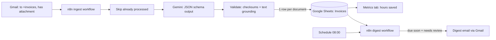
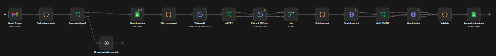
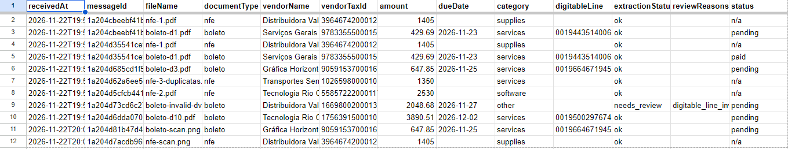
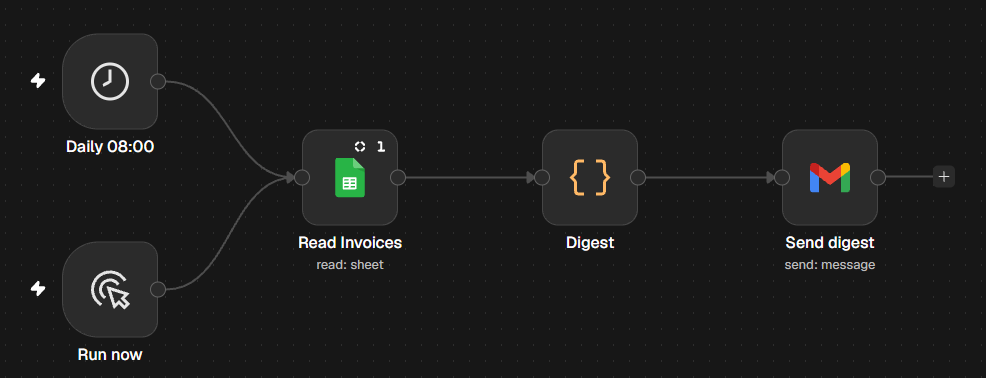
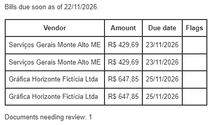
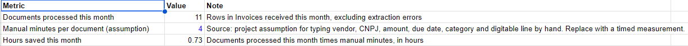

# Invoice Processing Automation

An n8n automation that reads Brazilian invoices (DANFE) and bank slips (boletos) from a Gmail inbox, extracts the fields with Gemini, checks them in code, writes one row per document to Google Sheets, and emails a daily digest of unpaid bills that are due soon.

## Problem

Someone in finance opens each email, reads the PDF or photo, and types vendor, tax ID, amount and due date into a spreadsheet. It is slow and easy to get wrong, and a missed due date costs a late fee. A vision LLM can read these documents, but it can also invent a CNPJ, an amount or a due date. A wrong value shown as correct is worse than an empty cell.

## Solution

Two n8n workflows:

- **Ingest**: every email sent to a dedicated `+invoices` address with a PDF or image attachment is read, extracted with Gemini (strict JSON schema), and **validated in code**. Any field the document does not support is set to empty and the row is marked `needs_review` with a reason code. A failed extraction still produces a row. Attachments that are not a PDF or an image go to the `Unsupported (dropped)` node and get no row.
- **Digest**: every day at 08:00 (America/Sao_Paulo) one email lists the `pending` bills that are due within 3 days or already overdue, plus a count of documents that need review. When nothing is due, no email is sent, so the needs-review count only reaches you on days with due bills.

The pattern is the same as in `meeting-notes-api`: schema-constrained model output plus grounding in code.

## Architecture



Everything runs in one self-hosted n8n container (2.48.7, bound to `127.0.0.1:5678`). The validation code lives in plain files (`src/validate.js`, `src/dedup.js`, `src/digest.js`), is unit-tested with `node --test`, and `scripts/inject.js` copies it into the workflow's Code nodes, so the tested code is the code that runs.



## How grounding works

Gemini is called through the REST `generateContent` endpoint with a `responseSchema` (default model `gemini-3.5-flash-lite`, configurable). The prompt asks for each field plus the verbatim text it came from, and `null` when the field is not visible. Then `src/validate.js` checks the result. A failed check sets the field to empty, adds a reason code, and makes the row `needs_review`.

| Check | Reason codes |
|---|---|
| CNPJ has 14 characters and valid check digits | `cnpj_invalid` |
| Boleto digitable line has 47 digits, valid field check digits (mod 10) and general check digit (mod 11) | `digitable_line_invalid` |
| Amount and due date encoded in a valid line must match the extracted ones (the line wins, the discrepancy is recorded). The due-date factor handles the 2025 reset. | `amount_mismatch_line`, `due_date_mismatch_line` |
| Amount is greater than 0; dates are real calendar dates; due date is within 1 year of the processing date | `amount_invalid`, `due_date_invalid`, `due_date_out_of_range` |
| For PDFs with a text layer, amount (Brazilian format, e.g. `1.234,56`) and CNPJ must appear in the extracted text. Skipped for scans, where the checksums carry the grounding. | `amount_not_in_text`, `cnpj_not_in_text` |
| One PDF holding several boletos | `multiple_boletos` |
| Required fields per type: boleto needs amount, due date and digitable line; nfe needs CNPJ and amount; other needs amount | `missing_amount`, `missing_dueDate`, `missing_digitableLine`, `missing_vendorTaxId` |

Which rows are bills to pay:

- `boleto` rows, and `other` rows with a due date, get `status = pending` and can appear in the digest.
- `nfe` rows are records only (`status = n/a`). A DANFE and its boleto usually arrive together, so listing both would count one bill twice.
- `paid` is set by hand in the sheet and removes the row from the digest.

Dedup key is `messageId:fileName`, so re-polling Gmail does not create duplicate rows.

## Setup

Requires Docker, Node 22+ (for the tests and scripts), a Google account, and a free [Google AI Studio](https://aistudio.google.com/) key. Use a throwaway Google account if you can (see [Security & limits](#security--limits)).

### 1. Start n8n

```bash
cp .env.example .env        # then fill in the values
docker compose up -d
```

`.env` values:

- `N8N_ENCRYPTION_KEY`: any long random string. Keep it: it encrypts the stored credentials.
- `INVOICE_INBOX`: your plus-address, for example `yourname+invoices@gmail.com`. Gmail delivers it to your normal inbox. The ingest query is `to:<INVOICE_INBOX> has:attachment` (`deliveredto:` does not match mail you send to yourself).
- `GEMINI_MODEL`: default `gemini-3.5-flash-lite`. Check AI Studio for current model names and limits.
- `DIGEST_WINDOW_DAYS`: default `3`.
- `SHEET_ID`: the id from the spreadsheet URL (step 4).

Open <http://localhost:5678> and create the owner account.

### 2. Google Cloud OAuth client

1. Create a Google Cloud project, then enable the **Gmail API** and the **Google Sheets API**.
2. Configure the OAuth consent screen (External, status **Testing**) and add your account as a test user.
3. Add only these scopes, and do not grant the full-mailbox "permanently delete" scope:
   - Gmail: "See and edit your email labels"
   - Gmail: "Read, compose, and send emails from your Gmail account"
   - Sheets: "See, edit, create, and delete all your Google Sheets spreadsheets"
   - Drive: "See, edit, create, and delete only the specific Google Drive files you use with this app" (`drive.file`)
4. Create an OAuth client of type **Web application** with redirect URI `http://localhost:5678/rest/oauth2-credential/callback`.
5. Keep the client id and secret for the next step. They go into n8n only, never into this repo.

### 3. n8n credentials

In n8n, create three credentials. The names below are suggestions; the committed workflow JSON has no credential references, so after importing you select them on each node:

- `Gmail account`: Gmail OAuth2, using the client id and secret from step 2. Click connect and approve.
- `Google Sheets account`: Google Sheets OAuth2, same client.
- `Gemini API key`: Header Auth, header name `x-goog-api-key`, value your AI Studio key.

### 4. Spreadsheet

Create a Google Sheet and put its id in `.env` as `SHEET_ID`. Add two tabs.

`Invoices`, with this exact header row in A1:M1:

```
receivedAt, messageId, fileName, documentType, vendorName, vendorTaxId, amount, dueDate, category, digitableLine, extractionStatus, reviewReasons, status
```

`Metrics`:

| Cell | Content |
|---|---|
| A1 / B1 / C1 | `Metric`, `Value`, `Note` |
| A2 / B2 | `Documents processed this month`, then `=SUMPRODUCT((LEFT(Invoices!A2:A,7)=TEXT(TODAY(),"yyyy-mm"))*(Invoices!K2:K<>"error")*(Invoices!A2:A<>""))` |
| A3 / B3 | `Manual minutes per document (assumption)`, then `4` |
| A4 / B4 | `Hours saved this month`, then `=B2*B3/60` |

B2 counts the rows received this month whose `extractionStatus` is not `error`.

### 5. Import the workflows

```bash
docker compose cp workflows/ingest.json n8n:/tmp/ingest.json
docker compose cp workflows/digest.json n8n:/tmp/digest.json
docker compose exec n8n n8n import:workflow --input=/tmp/ingest.json
docker compose exec n8n n8n import:workflow --input=/tmp/digest.json
```

`n8n import:workflow` deactivates the workflow. In the UI, open each workflow, **re-select the credentials on every node that uses one**, save, and publish it. The ingest workflow then polls Gmail every minute; the digest has a `Run now` trigger next to the 08:00 schedule for testing.

### 6. Tests

```bash
npm test      # node --test, no network and no API key needed
```

## Sample data

`samples/` holds 9 fictional documents (the companies, invoices and amounts are fictional; CNPJs are generated with valid check digits from random roots, so they may coincide with real registrations): 3 DANFE PDFs (one with 3 installments, "duplicatas"), 3 boleto PDFs, 1 boleto with a wrong check digit, and 2 scanned PNGs (rotation and noise). `samples/expected.json` is the reference of what each sample should extract; I used it for the end-to-end comparison against the sheet rows.

Due dates are relative to the generation day, so regenerate before a demo, otherwise nothing falls into the digest window:

```bash
node scripts/generate-samples.js     # needs Chrome (CHROME_PATH to override); output in samples/out/
```

`scripts/scanify.py` makes the scanned PNGs (needs Python, Pillow and `pdftoppm`). Email the files to your `+invoices` address.

## Demo run (2026-11-22)

I emailed the 9 sample documents to the `+invoices` address. All 9 extracted rows matched `samples/expected.json` (type, CNPJ, amount, due date, digitable line, status). The boleto with the wrong check digit came out `needs_review` with `digitable_line_invalid`. The sheet ended with 11 rows because two documents were emailed twice in separate emails during setup (different message ids, so they are not duplicates by the dedup key).



Digest test: the email subject said "Bills due soon: 4". After I set one row to `paid`, the next run said "Bills due soon: 3".





## Metric

The `Metrics` tab computes hours saved as `documents this month x manual minutes per document / 60`.

- Demo run: 11 documents x 4 minutes = **0.73 hours** saved.
- The 4 minutes per document is **my assumption, not a measurement**: roughly the time to open an email, read the document and type the fields into a sheet. Change cell B3 to your own number.
- 11 documents is a demo volume, not real usage.
- Illustrative projection only, not a result: at 200 documents a month, 200 x 4 / 60 = 13.3 hours a month.



## Failure behavior

- A Gemini error, or invalid JSON after one retry, still writes a row with `extractionStatus = error` and the reason in `reviewReasons`.
- If PDF text extraction fails, the document is still processed; it just has no text layer to ground against (`pdfText` is empty).
- A Google Sheets read or append failure fails the execution, and no row is written for that run. Once Sheets is reachable again, open the n8n Executions list and use Retry on the failed execution. Retry reruns the same email, and dedup (`messageId:fileName`) skips any attachment that was already appended.
- An `error` row blocks re-processing of that attachment (dedup key `messageId:fileName`), and re-running from Executions does not retry it. To recover, delete the row, then re-send or forward the attachment to the `+invoices` address. The new email has a new message id, so dedup does not block it.
- Due dates edited by hand must be typed as `YYYY-MM-DD` plain text. Any other format (or a date the sheet converted) is ignored by the digest.
- The needs-review count in the digest excludes `paid` rows. To clear an item after reviewing it, fix the fields and set `extractionStatus` to `ok` (or mark it `paid`).

## Security & limits

- **Demo only, fictional data.** On the AI Studio free tier Google may use prompts to improve its products. Do not send real invoices.
- **The Gmail credential is account-wide.** Google OAuth cannot restrict it to one label, so the n8n credential can read the whole mailbox. The workflow only processes mail matching the `+invoices` query, but the access is broader than that. Use a dedicated or throwaway Google account.
- Credentials stay in n8n's encrypted local store (`N8N_ENCRYPTION_KEY` in `.env`, git-ignored; `n8n-data/` is git-ignored). n8n listens on `127.0.0.1` only.
- `N8N_BLOCK_ENV_ACCESS_IN_NODE=false` lets workflow nodes read `.env` values, including the encryption key. Acceptable for a single-user localhost instance, not for a shared one.
- With the consent screen in Testing mode, the refresh token expires after 7 days; reconnect the credential in n8n.
- **When you are done, revoke the grant:** myaccount.google.com, Security, Third-party connections, remove the app. Then delete the OAuth client.
- Out of scope, by design:
  - DANFE with installments (duplicatas): the total amount is kept, the due date is empty.
  - Payment booklets (one PDF with several boletos): the row becomes `needs_review` with `multiple_boletos`.
  - Convenio boletos (48-digit lines, utilities and taxes): they fail the 47-digit check and are flagged `digitable_line_invalid`.
  - Invoices paid without a boleto (PIX, transfer): they produce no alert.
  - Inline images (for example signature logos) count as attachments and may produce `other` or `needs_review` rows.
