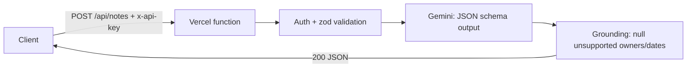
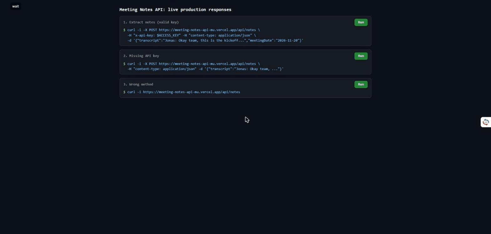
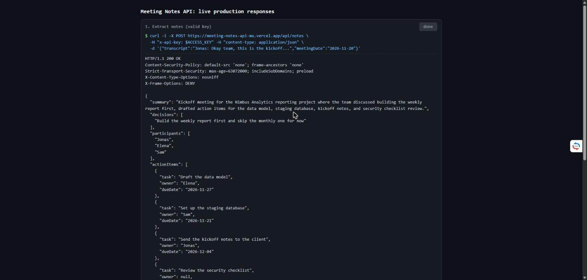

# Meeting Notes API

A small serverless API that turns a raw meeting transcript into structured notes: summary, decisions, participants and action items (task, owner, due date).

## Problem

Meeting transcripts are long and nobody rereads them. LLMs can summarize them, but they also invent things: an owner who never spoke, a deadline nobody mentioned. Notes with made-up owners and dates are worse than no notes.

## Solution

`POST /api/notes` sends the transcript to Gemini with a strict JSON schema, then **grounds** the output against the original text before returning it. Anything the transcript does not support is set to `null` instead of guessed.

## Architecture



TypeScript on Vercel serverless (Node 22), `@google/genai` for the model call, `zod` for request and model-output validation.

## How grounding works

The model is asked for each action item's `owner`, `dueDate` and `deadlineSource` (the verbatim transcript phrase the deadline came from). Then, in code (`src/grounding.ts`):

- **Owner** is set to `null` if the name does not appear in the transcript as a whole word (accent- and case-insensitive).
- **Due date** is set to `null` if its `deadlineSource` phrase is not found in the transcript.
- **Without `meetingDate`**, a due date is also set to `null` unless both the day number and the 4-digit year appear in its source phrase ("by March 7" becomes `null`, "by March 7, 2026" is kept). Relative deadlines ("next Friday") are only resolved when you send `meetingDate`.
- `deadlineSource` is internal and is not part of the response.

Each correction is logged (no transcript content) as a `grounding_correction` event.

## API

`POST /api/notes`, header `x-api-key: <ACCESS_KEY>`, JSON body:

| Field | Type | Notes |
|---|---|---|
| `transcript` | string | required, 1 to 50,000 chars |
| `meetingDate` | string | optional, `YYYY-MM-DD`; needed to resolve relative deadlines |

Response `200`:

```json
{
  "summary": "string",
  "decisions": ["string"],
  "participants": ["string"],
  "actionItems": [{ "task": "string", "owner": "string | null", "dueDate": "YYYY-MM-DD | null" }]
}
```

Errors always have the shape `{ "error": { "code", "message" } }`:

| Status | code | When |
|---|---|---|
| 400 | `invalid_request` | invalid JSON or body fails validation |
| 401 | `unauthorized` | missing or wrong `x-api-key` |
| 405 | `method_not_allowed` | any method other than POST |
| 429 | `rate_limited` | Gemini free-tier quota reached |
| 502 | `upstream_error` | model call failed, timed out or returned invalid output (for example Gemini "high demand" 503s) |
| 500 | `internal_error` | unexpected error or missing env vars |

Full contract: [`openapi.yaml`](openapi.yaml) (OpenAPI 3.1).

## Run locally

Requires Node 22+ and the [Vercel CLI](https://vercel.com/docs/cli) (free account).

```bash
npm install
cp .env.example .env   # then fill in the values
vercel dev --listen 3000
```

`.env` values:

- `GEMINI_API_KEY`: free key from [Google AI Studio](https://aistudio.google.com/) (no billing needed).
- `ACCESS_KEY`: any long random string; clients send it as `x-api-key`.
- `GEMINI_MODEL`: a free-tier Flash model. The examples were generated with `gemini-3.5-flash-lite` (any current free-tier Flash-Lite works); `gemini-2.5-flash` is no longer available to new users. Free-tier daily request limits are per model: `gemini-3.8-flash` was limited to 20 requests/day, which is why a Flash-Lite model is used. Check AI Studio for the current model names and limits.

Try it:

```bash
curl -X POST http://localhost:3000/api/notes \
  -H "x-api-key: $ACCESS_KEY" -H "content-type: application/json" \
  -d '{"transcript":"Ana: I will send the report by May 3.","meetingDate":"2026-04-28"}'
```

## Examples

Fictional transcripts in [`examples/`](examples/), each with the real API output next to it:

| Transcript | Response | Notes |
|---|---|---|
| `en-product-sync.txt` | `en-product-sync.json` | English, no `meetingDate` |
| `pt-reuniao-semanal.txt` | `pt-reuniao-semanal.json` | Portuguese, output stays in Portuguese |
| `en-relative-deadlines.txt` | `en-relative-deadlines.json` | sent with `meetingDate` `2026-03-02` ("next Friday", "tomorrow") |

## Screenshots / demo

The API was deployed to Vercel at `https://meeting-notes-api-mu.vercel.app/api/notes` (behind an `x-api-key`). That deployment is now offline; to run it yourself, see [Run locally](#run-locally) or [Deploy](#deploy).

Real responses captured from that deployment: a valid request (200 with security headers and grounded notes, sent with `meetingDate` `2026-11-20`, a Friday), a missing key (401) and a `GET` (405).





## Tests

```bash
npm test          # unit tests (vitest), no network or real API key needed
npm run typecheck
```

## Deploy

1. Push the repo to GitHub and import it in Vercel.
2. Set the project **Root Directory** to `meeting-notes-api/`.
3. Add environment variables `GEMINI_API_KEY`, `ACCESS_KEY` and `GEMINI_MODEL` (Production and Preview).
4. Deploy. `vercel.json` sets the function `maxDuration` to 60 s.

The function fails closed: if any of the three variables is missing it returns `500 internal_error`.

## Free-tier note

This is a portfolio demo on free tiers (Vercel Hobby, Gemini free tier). Use **fictional data only**: on the Gemini free tier, Google may use submitted inputs to improve its products. Quota limits and model availability change; expect occasional `429` or `502` responses.
